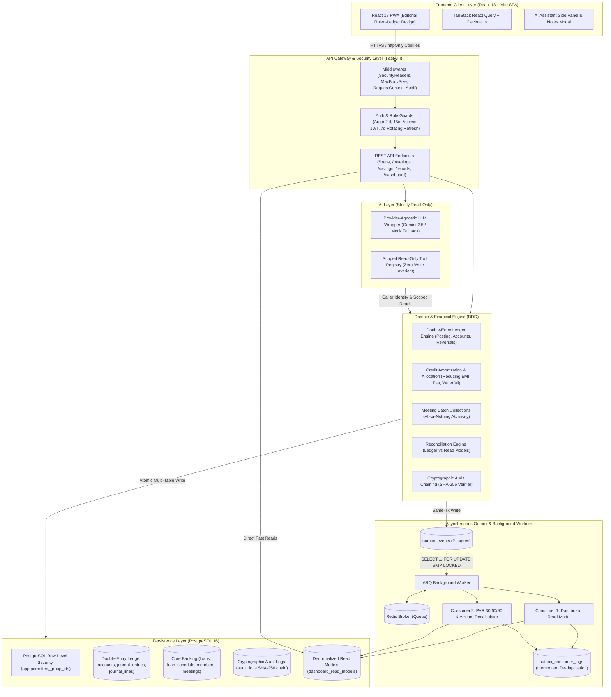
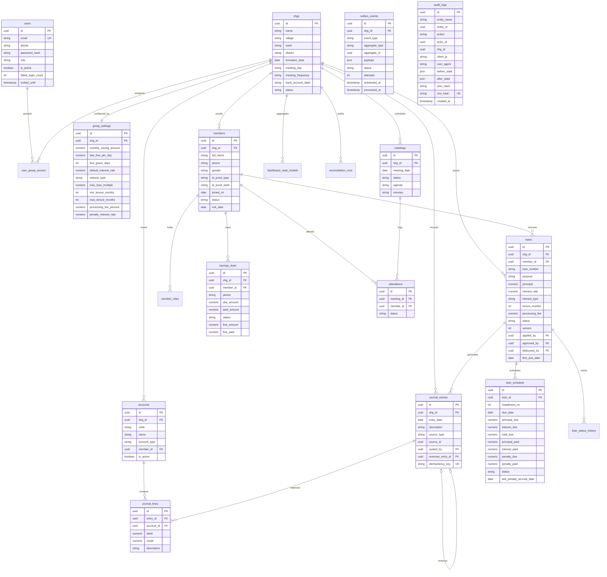

# System Architecture & Technical Specifications - SHG Credit Manager

This document provides a comprehensive overview of the system architecture, component boundaries, data persistence model, transactional guarantees, and resilience patterns powering the **SHG Credit Manager**.

---

## 1. High-Level Architecture Diagram

---

## 2. Entity-Relationship (ER) Data Model

---

## 3. Transactional Guarantees & Resilience Patterns

### 3.1 Double-Entry Invariant Enforcement
Financial integrity is enforced at multiple defense layers:
1. **Per-Line Exclusive Constraint**: Database check constraint guarantees that exactly one side is non-zero:
   $$(debit > 0 \land credit = 0) \lor (debit = 0 \land credit > 0)$$
2. **Transaction Balance Verification**: In `app/domain/ledger/posting.py`, every posting validates:
   $$\sum \text{debits} - \sum \text{credits} = 0.00$$
   Any imbalance raises `LEDGER_UNBALANCED_ENTRY` and immediately rolls back the transaction.
3. **Append-Only Immutability**: Journal entries and lines cannot be updated or deleted. Corrections are executed via mirror reversal vouchers (`reverses_entry_id`). An entry can only be reversed once.

### 3.2 Transactional Outbox Pattern
To prevent dual-write bugs between PostgreSQL and asynchronous workers:
1. State mutations (disbursals, collections, repayments) write their domain records, ledger entries, and an `outbox_events` row in the **exact same database transaction**.
2. An ARQ worker polls `outbox_events` using `SELECT ... FOR UPDATE SKIP LOCKED`.
3. Consumers process events idempotently, updating denormalized read models (`dashboard_read_models`) and recalculating portfolio risk metrics (PAR 30/60/90).
4. Composite uniqueness on `(consumer_name, event_id)` prevents double-execution during worker failover or crash restarts.

### 3.3 Defense-in-Depth Row-Level Security (RLS)
Data tenancy is protected by two distinct layers:
1. **Application-Level Filtering**: Every query scopes explicitly by permitted `shg_id` retrieved from JWT session permissions.
2. **Postgres Row-Level Security**: Group-scoped tables enforce Postgres RLS using session settings (`SET LOCAL app.permitted_group_ids = '...'` and `SET LOCAL app.is_admin = 'true'`). Direct or accidental unfiltered SQL queries cannot cross group isolation boundaries.

### 3.4 Cryptographic SHA-256 Tamper-Evident Audit Chain
Every database write writes an audit event where:
$$\text{row\_hash} = \text{SHA256}(\text{prev\_hash} \mathbin{\Vert} \text{canonical\_json}(\text{entry}))$$
Using `python -m app.audit.verifier`, field supervisors or external auditors verify the entire blockchain-inspired audit log at > 20,000 rows/second, detecting unauthorized row tampering or deletion instantly.
